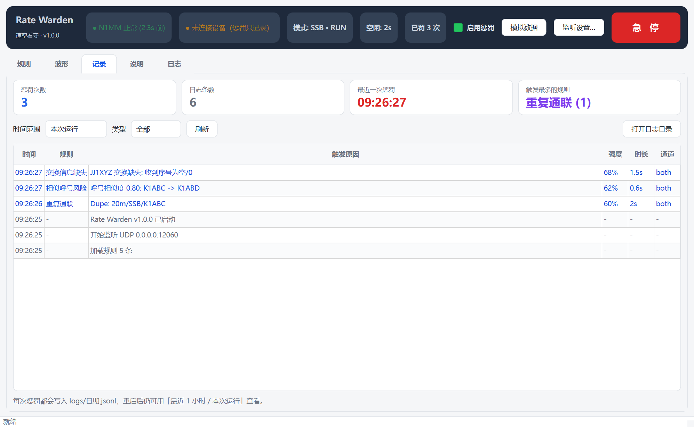
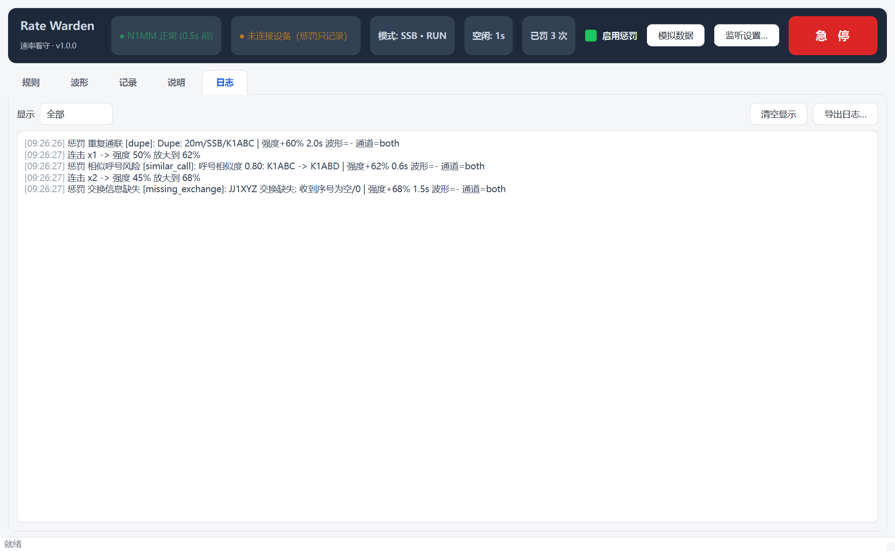

# Rate Warden · 速率看守

> 把 **N1MM Logger+** 和 **DGLab** 连起来的比赛速率看门狗。
> 监听 N1MM 的 UDP 广播，按可插拔规则判定「空窗」与「操作失误」，通过 **DGHub** 对设备施加惩罚。

**30 秒没完成 QSO 就罚一次，有就继续计时。** —— 这是内置的 `RUN 空窗` 规则。

[](https://www.python.org/)
[](https://pypi.org/project/PySide6/)
[](./rate_warden/__init__.py)
[](./LICENSE)
[](#已知限制)

---

## 目录

- [它能做什么](#它能做什么)
- [截图](#截图)
- [快速开始](#快速开始)
- [界面](#界面)
- [内置规则](#内置规则)
- [关于「波形」的澄清](#关于波形的澄清)
- [自己写规则](#自己写规则)
- [配置](#配置)
- [N1MM 配置](#n1mm-配置)
- [安全](#安全)
- [自检](#自检)
- [目录结构](#目录结构)
- [打包与分发](#打包与分发)
- [贡献与已知限制](#贡献与已知限制)
- [许可](#许可)

---

## 它能做什么

- **UDP 无侵入监听** —— 只被动接收 N1MM 的 `ContactInfo` / `LookupInfo` / `RadioInfo`，不改日志、不改数据库、不占用 N1MM 的焦点。
- **可插拔规则** —— 每条规则就是一个独立的 `.py` 文件，GUI 里导入即生效，可热重载；参数表单自动根据 `params_schema` 生成。
- **分级惩罚 + 连击递进** —— 失误类规则连续触发时强度递增（每级 +25%，封顶 2 倍），再在 `strength_cap` 处硬夹；节奏类规则不参与递进。
- **三层可追溯记录** —— 顶栏计数、记录页时间线（原因/强度/时长/通道）、磁盘 `logs/YYYY-MM-DD.jsonl`，重启后仍可回看。

---

## 截图

**惩罚时间线** —— 什么时候、哪条规则、什么原因、多强、多久：



**记录与统计** —— 带筛选、统计卡片与上下文（连击数、倍数、是否送达）：



---

## 快速开始

需要 **Python 3.11+**。GUI 依赖 `PySide6`；真实下发惩罚另需 `dghub-sdk`（DGHub 主程序通常自带）。

```powershell
cd rate_warden

# 建议先建虚拟环境（可选）
python -m venv .venv
.\.venv\Scripts\Activate.ps1
python -m pip install -r requirements.txt

# 1. 先离线自检（不需要 N1MM / DGHub / 设备）
python main.py --check

# 2. 打开界面（自动尝试连 DGHub，连不上就降级为"只记录"）
python main.py

# 3. 只想看界面、不碰设备
python main.py --demo

# 4. 只看版本
python main.py --version
```

没有 `dghub-sdk` 时程序不会崩，会自动降级成 `NullSink`：惩罚照常判定、照常写日志，只是不下发到设备。

---

## 界面

左侧五个页面：

| 页 | 用途 |
|---|---|
| **规则** | 勾选启用、按参数表单调参、导入 `.py`、新建模板、编辑源码、重新扫描 |
| **波形** | 导入预设名（粘贴 / 文件 / 内置参考）、编辑别名与备注、预览试放 |
| **记录** | 惩罚时间线：时间戳、规则名、触发原因、实际强度、时长、通道；带统计卡片与筛选 |
| **说明** | 规则写作指南、波形与协议真相、N1MM + DGHub 配置步骤 |
| **日志** | 实时文本日志，可按「警告 / 仅惩罚」过滤、导出 |

顶栏常驻：**N1MM 数据灯**、**DGHub 设备灯**、**RUN/S&P 指示**、**空闲计时**、**已罚次数**、**急停**按钮（红色，直连 sink，不经过规则引擎）。

---

## 内置规则

| 规则 id | 名称 | 触发条件 | 默认强度 / 时长 | 类别 |
|---|---|---|---|---|
| `empty_window` | RUN 空窗 | RUN 模式下 30s 无新 QSO（带冷却） | 40% / 1.0s | 节奏 |
| `dupe` | 重复通联 | 同波段同模式的呼号已通联过 | 60% / 2.0s | 失误 |
| `similar_call` | 相似呼号风险 | 与上一条呼号相似（`K1ABC` → `K1ABD`）且间隔 < 15s | 50% / 0.6s | 失误 |
| `missing_exchange` | 交换信息缺失 | 按比赛规则勾选的交换项为空，或序列号为 0 | 45% / 1.5s | 失误 |
| `lookup_timeout` | 磕台超时 | 按下 Tab / 空格后 90s 仍未落库 | 55% / 1.5s | 失误 |

**S&P 豁免**：`empty_window` 只在 RUN 模式下判定。S&P 本来就是「扫、听、叫」的稀疏节奏，空窗不代表摸鱼。
另外它默认 `require_radio`：N1MM 从未广播过运行状态时保持沉默，避免程序一启动就误罚。

**连击递进**：`dupe`、`similar_call`、`missing_exchange`、`lookup_timeout` 属于失误类（规则里的 `axis = "mistake"`），
连续触发时强度按 +25%/级 递增，封顶 2 倍，并在 `config.strength_cap` 处硬夹。
`empty_window` 属于节奏类（`axis = "rate"`），不参与递进。

**合并**：一个 QSO 同时命中多条规则时，只发送强度最高的一条，避免多条波形在手机队列里叠着播。

---

## 关于「波形」的澄清

DGHub 的插件协议里，`trigger` / `pulse` **只接受波形预设名字符串**（例如 `"CS2-受伤"`），
**不支持**插件下发任意 HEX 帧数据 —— 真正执行波形的是手机上的 DGHub APP。

所以本程序的「波形库」管理的是：**预设名 + 用途别名 + 备注 + 来源**，规则里引用的就是这个预设名。
名字必须与 DGHub 中显示的**逐字一致**（大小写、`-`、`_` 都不能差），否则触发会被设备侧丢弃。

`waves/library.json` 字段：

| 字段 | 含义 |
|---|---|
| `name` | DGHub 里的预设名，**逐字一致**才生效 |
| `alias` | 你自己起的用途别名（如「短促刺痛」） |
| `note` | 备注：适合什么规则场景 |
| `source` | `seed` = 首次启动种入的参考名，其余为导入来源 |

首次启动会种入一组参考预设名。**请把左边的名字改成你在 DGHub 里实际看到的**，之后再到规则页把 `waveform` 参数指向它。

---

## 自己写规则

规则就是 `rules_user/` 下的一个 `.py` 文件。GUI 里点「新建规则」会生成模板：

```python
from rate_warden.rule_base import Rule, Param, Context, common_penalty_params

class MyRule(Rule):
    id = "my_rule"
    name = "我的规则"
    description = "一句话说明触发条件"
    events = ("contact",)          # contact / tick / lookup / radio
    axis = "mistake"               # mistake 参与连击递进；rate 不参与
    params_schema = [
        Param("threshold", "阈值", "int", 3, 1, 10, help="悬停说明"),
        *common_penalty_params(default_strength=40, default_duration=1.0),
    ]

    def on_contact(self, ctx: Context):
        if ctx.contact and len(ctx.contact.call) < int(self.get("threshold")):
            return self.event(ctx, reason="呼号太短")
        return None
```

要点：

- `common_penalty_params()` 一次性给出标准的「强度 / 时长 / 波形 / 通道」四个参数，不用自己重复声明。
- `params_schema` 里的每个 `Param` 都会在 GUI 变成一个控件，`help` 文字显示为悬停提示。
- `ctx` 是只读快照：`ctx.contact`、`ctx.now`、`ctx.is_running`、`ctx.worked`、`ctx.idle_seconds` 等；需要跨事件保存状态时用 `ctx.state`。
- 返回 `PenaltyEvent` 表示惩罚，返回 `None` 表示放行。用 `self.event(ctx, reason=...)` 生成最省事。

导入时会做静态校验，违反以下任意一条直接拒绝：

1. 规则文件之间**禁止互相 import**（保证可热重载）；
2. 只能依赖 `rate_warden.rule_base` 与标准库；
3. 必须定义至少一个带 `id` 的 `Rule` 子类。

> ⚠️ 导入 `.py` 即执行代码 —— **只导入你自己信任的文件**。

---

## 配置

配置在项目根目录的 `config.json`，首次运行自动生成（该文件已加入 `.gitignore`，不入库）。
参考默认值见 [`config.example.json`](config.example.json)。

| 键 | 默认 | 说明 |
|---|---|---|
| `udp_port` | `12060` | 监听 N1MM 广播的端口，须与 N1MM 里填写的一致 |
| `udp_bind` | `0.0.0.0` | 绑定地址；只收本机广播时填 `127.0.0.1` |
| `strength_cap` | `70` | **强度硬上限**，连击叠加后也不会突破 |
| `heartbeat_hz` | `4` | 内部心跳频率（Hz），决定 tick 类规则的判定粒度 |
| `default_channel` | `both` | 默认通道：`a` / `b` / `both` |
| `master_enabled` | `false` | 总开关；关掉时只记录不下发 |
| `run_rules` | `{}` | 每条规则的 `{"enabled": bool, "params": {...}}`，由 GUI 写入 |

> 注意：`config.example.json` 里 `master_enabled` 为 `false`，这是刻意保守的参考值。程序首次运行生成 `config.json` 时，`master_enabled` 沿用代码内置默认 `true`；**建议在真机上先把它关掉，用 `--demo` 验证行为后再打开**。

---

## N1MM 配置

1. `Config → Configure Ports → Broadcast Data`
2. 勾选 **Contacts**，目标地址 `127.0.0.1`，端口 `12060`
3. 想用「磕台超时」规则，再勾选 **External Callsign Lookup**
4. Windows 防火墙首次会弹窗，允许**私有网络**即可

端口被占用时，点顶栏「监听设置…」改端口，改完自动重开监听。

---

## 安全

- 所有惩罚走 `rollback` 模式，到时**自动回到 baseline**，不会残留强度。
- `config.json` 的 `strength_cap`（默认 70）是硬上限，连击叠加也不会突破。
- 顶栏**急停**立即把 A/B 通道归零；关窗时也会自动归零。
- 空窗规则默认 `require_radio`：N1MM 从未广播运行状态时保持沉默，防止启动即误罚。
- 建议先用 `--demo` 模式或「模拟数据」按钮验证链路，再逐条启用规则；`master_enabled` 保持 `false` 直到你确认行为可接受。

---

## 自检

```powershell
python main.py --check
```

不需要 N1MM、不需要 DGHub、不需要设备，返回码 0 表示全部通过。覆盖 16 项：

规则发现、参数类型校验、导入校验（语法错 / 无规则 / 互相 import）、空窗触发与冷却、S&P 豁免、
Dupe 判定（含撤回）、相似呼号、同一 QSO 只罚一次、连击递进与封顶、磕台超时、交换缺失、
N1MM XML 解析、端到端事件链、波形库、Sink 急停。

---

## 目录结构

```
rate_warden/
├─ main.py                 入口（--check / --demo / --version）
├─ manifest.json           DGHub 插件清单
├─ dghub_plugin/main.py    DGHub 拉起时的入口（上报启动检查后开 GUI）
├─ config.example.json     配置参考（config.json 首次运行自动生成，不入库）
├─ requirements.txt
├─ rate_warden/
│  ├─ rule_base.py         规则契约：Param / PenaltyEvent / Context / Rule
│  ├─ engine.py            状态机、事件分发、合并、连击递进
│  ├─ loader.py            扫描 / 校验 / 导入 / 热重载规则
│  ├─ n1mm.py              UDP 监听线程 + XML 解析
│  ├─ sink.py              DghubSink（真实）/ NullSink（离线）
│  ├─ waveforms.py         波形库（预设名与元数据管理）
│  ├─ eventlog.py          三层记录（JSONL）
│  ├─ gui.py               PySide6 五页界面
│  ├─ theme.py             界面主题
│  ├─ selftest.py          16 项离线自检
│  └─ rules/               5 条内置规则
├─ rules_user/             你自己导入的规则（*.py 不入库）
├─ waves/                  波形库（library.json）
├─ logs/                   运行日志（*.jsonl 不入库）
└─ docs/screenshots/       README 截图
```

---

## 打包与分发

两种分发方式：

**① 独立 exe（PyInstaller）**

```powershell
pyinstaller --onedir --windowed --name RateWarden ^
  --hidden-import dghub_sdk ^
  main.py
```

- **用 `--onedir`，不要用 `--onefile`**：Qt6 的 `--onefile` 不会自动部署平台插件，目标机容易报 `platform plugin not found`。
- 打包后对 `dist/RateWarden` 里的 Qt DLL 跑一次 `windeployqt`。
- `rules_user/`、`waves/`、`logs/` 必须留在 exe **外面**，规则才能热加载、波形库才能编辑。

**② 作为 DGHub 插件**

`manifest.json` 已按 DGHub 插件清单写好（`entry` 指向 `dghub_plugin/main.py`，带 `startup_check` 能力）。
把整个 `rate_warden/` 目录放进 DGHub 的插件目录即可，DGHub 拉起时会先上报启动检查，再打开 GUI。

---

## 贡献与已知限制

- **贡献**：最受欢迎的贡献是**新规则插件**（放 `rate_warden/rules/` 并附带一句 `description`）和**波形预设名对照**。改代码前请先跑 `python main.py --check` 保证 16/16。
- **已知限制**：
  - Windows 优先验证；Linux / macOS 理论上可跑，但未做实测。
  - N1MM 的 UDP 广播**无认证**，请只在可信局域网内使用。
  - 波形是否生效取决于 DGHub 里的预设名是否逐字匹配 —— 程序无法替你校验 APP 侧的波形是否存在。
  - 只接受 `.py` 规则插件，不支持从网络加载规则。

---

## 许可

[MIT](LICENSE) © 2026 bh8gef

---

### 首次推送到 GitHub

```powershell
cd rate_warden
git init -b main
git add -A
git commit -m "Rate Warden 1.0.0: N1MM x DGLab 速率看门狗"
git remote add origin https://github.com/<你的用户名>/rate-warden.git
git push -u origin main
```
